<div align="center">

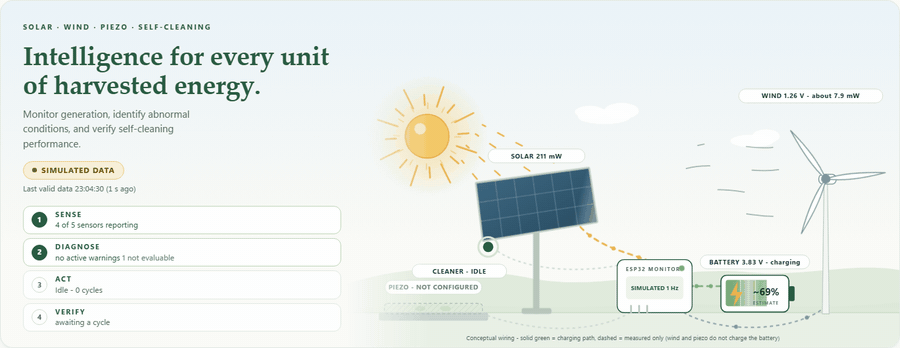

# ⚡ HARVESTIQ

### Intelligence for every unit of harvested energy.

**An ESP32 multi-source energy harvester (☀️ solar · 🌬️ wind · 👣 piezo) with a self-cleaning solar panel,**
**and a browser dashboard that is beautiful, works offline, and is honest about what it does not know.**

<br>

[](https://mukesh-240.github.io/harvestiq/?demo=9)


[What it is](#-what-is-harvestiq) •
[Quick start](#-quick-start) •
[Tour](#%EF%B8%8F-a-tour-of-the-dashboard) •
[Hardware](#-the-hardware) •
[Architecture](#%EF%B8%8F-how-it-works) •
[Honesty rules](#-honest-by-design) •
[Demo scenarios](#-17-demo-scenarios) •
[Tests](#-tests)

</div>

---

## 🌱 What is HARVESTIQ?

Small renewable sources each make a little energy. A solar panel makes the most, but only while it is clean. A small wind
generator makes energy in gusts. A piezo tile makes a tiny pulse with every footstep. **HARVESTIQ** puts all three on one
**ESP32**, stores what they make in an **18650 battery**, and keeps the panel clean with a **vibration motor** that runs when
output drops while the light is still bright.

The laptop dashboard follows one loop:

<div align="center">

| 🔍 **SENSE** | 🧠 **DIAGNOSE** | ⚙️ **ACT** | ✅ **VERIFY** |
|:---:|:---:|:---:|:---:|
| The ESP32 reads every source once per second and streams JSON over USB | The dashboard judges each sensor on its own evidence and explains anything suspicious | The ESP32 runs the cleaning cycle by itself when output is low in bright light | The dashboard compares solar output before and after cleaning and reports what changed |

</div>

> [!IMPORTANT]
> The dashboard **never controls the hardware**. The firmware decides when to clean, and the browser only watches, explains
> and verifies. This is intentional: the sketch accepts no commands, so there are no fake motor buttons.

### ✨ Highlights

- 🎬 **Animated live scene.** The sun, panel, turbine, piezo tile and battery move according to the real readings, not on a timer.
- 🩺 **Sensor Health Center.** Each of 8 channels gets a status and a confidence label, and each claim states what it is based on.
- 🚨 **Diagnostics with a lifecycle.** Alerts are ACTIVE, then RECOVERED, and are kept in history. They are never silently deleted.
- 🧪 **Honest cleaning verification.** Five possible outcomes, including two INCONCLUSIVE ones for when the evidence is too weak.
- 🎮 **17 demo scenarios.** Deterministic simulations run through the real parser, so you can present it without hardware.
- 🔌 **Plug and play.** Chrome or Edge, a USB cable, one click. No drivers, no backend, no cloud, no install.
- 📦 **One file.** `dist/harvestiq.html` is the whole app. Double-click it and it runs, even offline.
- ♿ **Accessible motion.** Respects `prefers-reduced-motion`, and every animated state also has a text label.

---

## 🚀 Quick start

### Option A: try it right now (no hardware)

👉 **[Open the live demo](https://mukesh-240.github.io/harvestiq/?demo=9)**, then pick any scenario and press **Start**.

### Option B: run it locally

```bash
git clone https://github.com/Mukesh-240/harvestiq.git
cd harvestiq
```

| Way to run | How | Notes |
|---|---|---|
| 📄 **Single file** (recommended) | Double-click **`dist/harvestiq.html`** | Works offline from `file://`. Web Serial works too. |
| 🖥️ **Local server** | `npm start` or double-click `start.bat`, then open http://localhost:8080 | Needs Node 20+ only for the 42-line static server |

> [!WARNING]
> Use **Chrome or Edge**. Firefox and Safari do not support Web Serial. Don't double-click `index.html`, because browsers block
> ES modules on `file://`. Use the single-file build or the server instead.

### Option C: connect a real ESP32

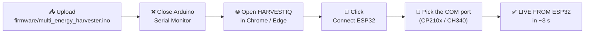

1. In the Arduino IDE, install the **Adafruit INA219** library, select your ESP32 board, and upload `firmware/multi_energy_harvester.ino`.
2. **Close the Serial Monitor.** Only one program can hold the COM port at a time.
3. Open HARVESTIQ, keep **LIVE** selected, click **Connect ESP32**, and pick the port.
4. Opening the port resets the ESP32, so expect about 2 to 3 seconds of boot text before the first reading arrives.

<details>
<summary><b>🛠️ Troubleshooting the connection</b></summary>

<br>

| Symptom | Fix |
|---|---|
| Connect button disabled or a red notice | You are not in Chrome/Edge, or the page is not on `http://localhost`, `https://` or `file://` |
| "Could not open the port" | Close the Arduino Serial Monitor and any other serial program, then replug the cable |
| No board in the port list | Use a data cable (some cables only charge), and install the CP210x or CH340 driver |
| Connected but **NO DATA** | Baud must be 115200 and the sketch must be running. Press **EN** on the board and check the Serial console |
| Lines marked malformed | A truncated line or `nan` from `printf`. These are harmless, ignored and counted |
| Solar **DISCONNECTED** | The firmware reports `ina:0`. Check INA219 VCC, GND, SDA → GPIO21 and SCL → GPIO22 |
| Piezo **NOT CONFIGURED** | Expected while `PIEZO_CONNECTED false`. After attaching the discs, set it to `true`, re-upload, and tick **Settings → Piezo attached** |
| Link drops | Keep the tab visible, check the cable, and press **Reconnect ESP32** |

</details>

---

## 🖼️ A tour of the dashboard

### The live scene

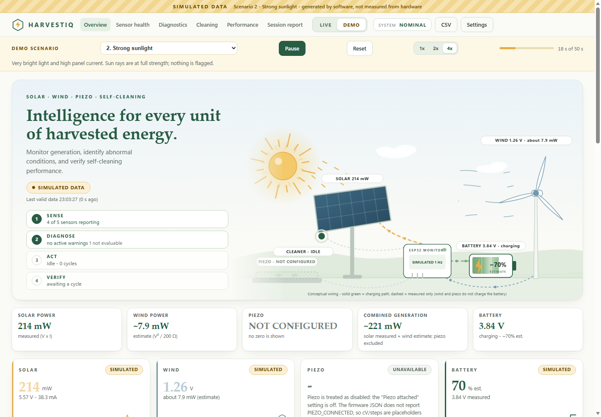

The scene is drawn from data. The sun's rays follow the LDR reading, the turbine spins with generator voltage, energy flows
along the wires only while power is measured, and the panel shakes only while the ESP32 reports `CLEANING`. If a sensor is
unavailable, its part of the scene **stops and is labelled**. It never keeps animating as if it were healthy.

### Live power summary and source cards

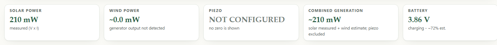
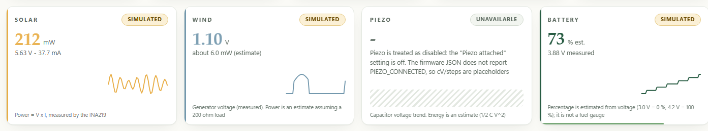

Measured values (solar V × I from the INA219) and **estimates** (wind power from V²/R, battery % from voltage) are labelled
differently. A missing reading appears as **"–"** with the reason. **It is never shown as zero.**

### 🩺 Sensor Health Center

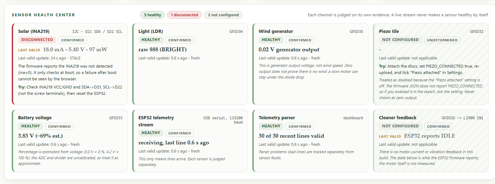

Every channel is judged separately: solar, light, wind, piezo, battery, the ESP32 stream, the telemetry parser and cleaner
feedback. A working USB stream **never** makes a sensor healthy by itself. Each tile shows the reading, how fresh it is, the
error, what to try, and what the browser **can't** know.

### 🚨 Diagnostics and serial connection

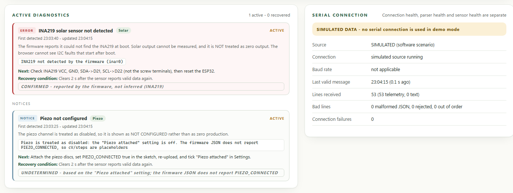

Each diagnostic records its **evidence**, when it was first detected and last updated, a **recommended action**, the
**recovery condition** and a **confidence** label. When it clears, it moves to *Recovered incidents* and stays in the history.

### 🧽 Cleaning cycle and verification

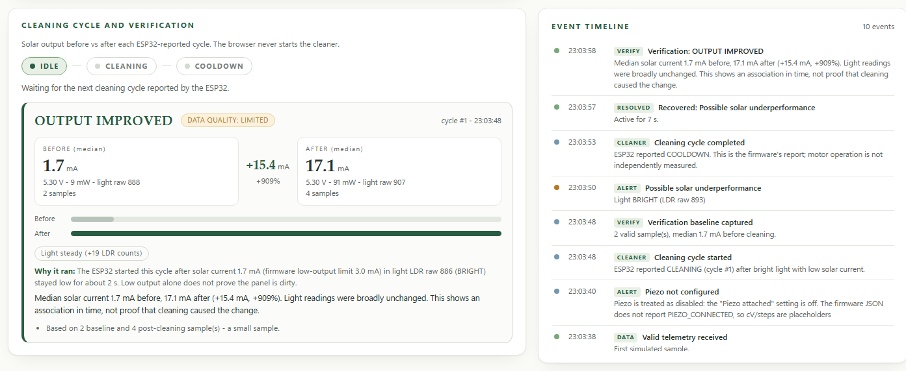

### 📈 Performance charts and raw serial console

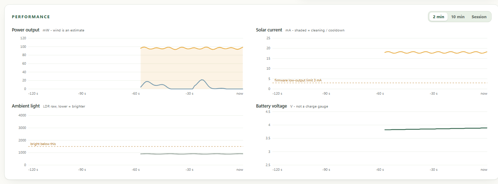
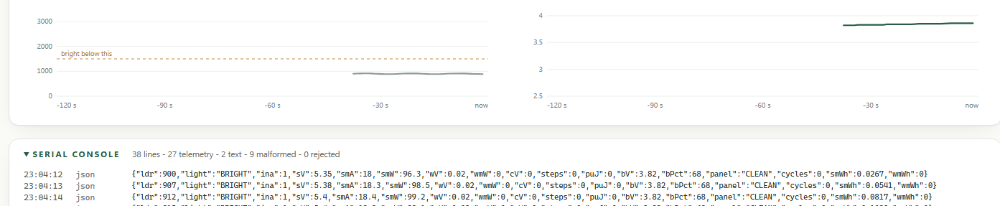

The charts are dependency-free SVG with 2-minute, 10-minute and session ranges. Telemetry gaps are drawn as gaps, not joined
with a line. The console shows every raw line from the ESP32, colour-coded as telemetry, text or malformed.

---

## 🔧 The hardware

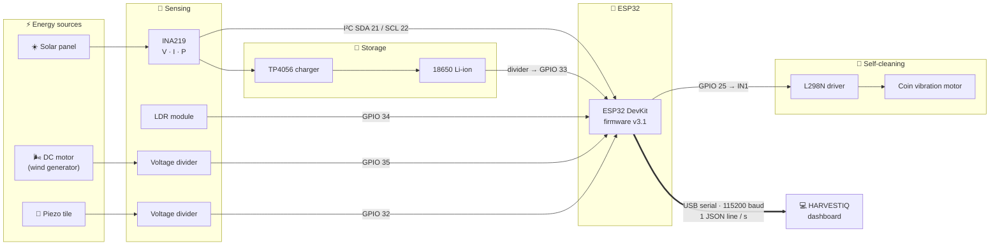

<details>
<summary><b>📌 Pin map</b></summary>

<br>

| ESP32 pin | Connected to | Purpose |
|---|---|---|
| GPIO 21 / 22 | INA219 SDA / SCL | Solar voltage, current, power (I²C) |
| GPIO 34 | LDR module AO | Ambient light (**higher reading = darker**) |
| GPIO 35 | Wind divider node | Generator voltage |
| GPIO 32 | Piezo divider node | Piezo capacitor voltage |
| GPIO 33 | Battery divider | 18650 voltage |
| GPIO 25 | L298N IN1 | Vibration cleaner motor |
| GPIO 26 | Status LED | On while cleaning |
| GPIO 27 / 14 / 12 | Solar / wind / piezo LEDs | Per-source activity |

</details>

### The self-cleaning logic (on the ESP32)

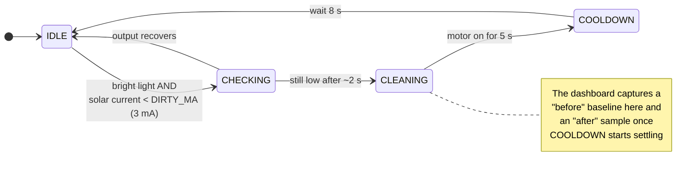

The panel never cleans in the dark or in dim light. Low output in low light is expected and is not treated as dirt.

---

## 🏗️ How it works

### Data path: from sensor to screen

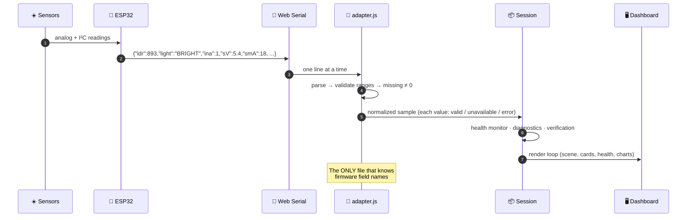

### Module map

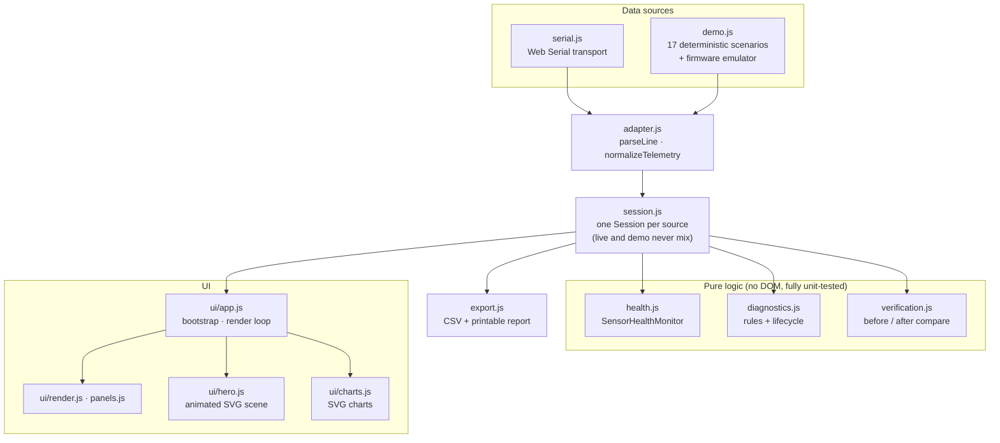

| Design decision | Why |
|---|---|
| **Zero dependencies, no framework** | Nothing to install or update, and it works offline on presentation day |
| **One adapter file** | If the firmware changes a field name, only `adapter.js` changes |
| **Separate live and demo sessions** | Simulated data can never leak into a live reading |
| **Demo lines go through the real parser** | The demo exercises the same code paths as the hardware |
| **Virtual clock for the demo** | Pausing or running at 4× never causes false "stale data" alerts |
| **Single-file build** (`build.mjs`) | Inlines every module, so the app runs by double-clicking it from `file://` |

---

## 🤝 Honest by design

These are the project's rules, and the code and tests enforce them:

> **Never fake a real sensor reading. Never silently hide a sensor failure. Never present a suspected fault as a confirmed hardware failure.**

| ❌ What a typical dashboard does | ✅ What HARVESTIQ does |
|---|---|
| Shows `0 mW` when a sensor is missing | Shows **"–"** and the reason (*missing*, *not detected*, *disabled in firmware*…) |
| Marks everything green while the USB link is up | Judges **each sensor separately**. A healthy stream says nothing about the INA219 |
| Calls a dark room a "sensor fault" | Knows the LDR reads high in the dark. Darkness is **not a failure** |
| Says "panel cleaned, output +900 %!" | Says **OUTPUT IMPROVED · data quality LIMITED**, and notes that this is an association, not proof |
| Deletes an alert when it clears | Marks it **RECOVERED** and keeps it in the history |
| Mixes demo and live numbers | Uses separate sessions, an amber **SIMULATED DATA** banner, and tags every value `source=demo` |

### Health statuses and confidence

| Status | Meaning |
|---|---|
| 🟢 **HEALTHY** | Valid, current readings, no problem detected |
| 🟡 **WARNING** | Needs attention, but the evidence is not conclusive |
| 🟠 **STALE** | No valid reading for more than 3.5 s while other channels still update |
| 🔴 **DISCONNECTED** | Cannot be read: no link, or the firmware reports the sensor missing |
| 🟣 **SUSPECTED FAILURE** | Evidence points to a fault but cannot prove it |
| ⚪ **NOT CONFIGURED** | Not enabled in this build (for example, the piezo). Never shown as zero |
| ⚫ **UNKNOWN** | Not enough information yet |

Every status also carries a **confidence** label: **CONFIRMED** (proven by a firmware report or by timing),
**SUSPECTED** (a software inference) or **UNDETERMINED** (cannot tell).

<details>
<summary><b>What counts as a fault, channel by channel</b></summary>

<br>

- **INA219 (solar):** `ina=0` is CONFIRMED by the firmware. The firmware checks only at boot, though, so the browser cannot see I²C faults that start later. A valid zero current is never treated as a failure.
- **LDR (light):** a dark room is not a failure. The channel becomes SUSPECTED only if it reads NIGHT for 20 s while the panel makes more than 10 mA. A reading pinned at the bright end, or identical for 5 minutes, is an UNDETERMINED warning and raises no alert.
- **Wind:** zero output is HEALTHY ("generator output not detected", which is not the same as "no wind"). No reading for 3.5 s is STALE, and for 30 s is SUSPECTED. The value is generator voltage, **not wind speed**.
- **Piezo:** NOT CONFIGURED unless enabled. Once enabled, quiet periods between footsteps are normal.
- **Battery:** a missing reading is never "empty". An implausibly low reading (below 2 V) is SUSPECTED, which usually means the divider or battery is disconnected. CHARGING or DISCHARGING is shown only when the voltage trend supports it.
- **Stream vs parser vs sensors:** these are three separate health signals. A burst of malformed lines doesn't make the solar panel "faulty".

</details>

### Cleaning verification outcomes

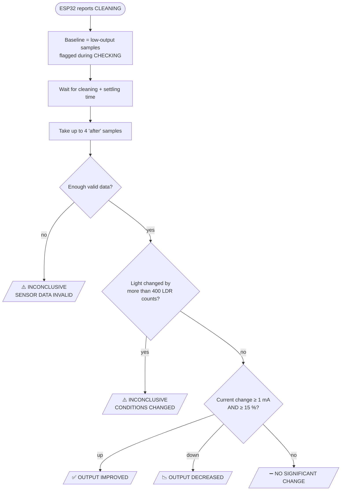

Because the firmware confirms for only about 2 s at 1 Hz, the baseline has about 2 samples. Even a clear improvement is
therefore rated **data quality: LIMITED**. A cycle that does not help raises a *"no improvement after cleaning"*
diagnostic. HARVESTIQ never claims that cleaning *caused* a change, only that one followed it.

---

## 🎮 17 demo scenarios

Click **DEMO**, pick a scenario, choose **1× / 2× / 4×** and press **Start**. Nothing is simulated until you press Start.
Deep link: `?demo=<number>`, for example **[`?demo=9`](https://mukesh-240.github.io/harvestiq/?demo=9)**.

| # | Scenario | What it demonstrates |
|:-:|---|---|
| 1 | Normal operation | Everything healthy; piezo NOT CONFIGURED exactly like the real build |
| 2 | Strong sunlight | Rays at full strength, high current, no warnings |
| 3 | Low sunlight | "Low output is consistent with low light". No cleaning suggested |
| 4 | Possible solar underperformance | Warning, a cleaning that does not help, the shade removed at 40 s, full recovery |
| 5 | Wind output fluctuating | Turbine speed follows voltage. Calm gaps say "output not detected", not "no wind" |
| 6 | Piezo pulse events | 12 footsteps. The tile presses only when a pulse is measured |
| 7 | Battery charging estimate | CHARGING → STABLE → DISCHARGING from the voltage trend |
| 8 | Cleaning cycle | IDLE → CHECKING → CLEANING (progress ring) → COOLDOWN (countdown) → IDLE |
| 9 | Cleaning → improved output | **OUTPUT IMPROVED**, data quality LIMITED |
| 10 | Cleaning, no improvement | Repeated NO SIGNIFICANT CHANGE and a "no improvement" diagnostic |
| 11 | INA219 communication failure | Solar DISCONNECTED (confirmed by firmware). The scene shows a warning, never zero |
| 12 | LDR stale / suspected failure | SUSPECTED FAILURE, then STALE when the field disappears |
| 13 | Wind data unavailable | STALE after 3.5 s, SUSPECTED after 30 s; other channels stay healthy |
| 14 | ESP32 disconnected | Telemetry timeout, all channels DISCONNECTED, link restored, history kept |
| 15 | Invalid telemetry | Truncated, NaN, wrong-type and impossible lines are ignored; parser health stays separate |
| 16 | Sensor recovery | INA219 and wind fail and return; incidents become RECOVERED and stay in history |
| 17 | Cleaning with changed light | **INCONCLUSIVE: CONDITIONS CHANGED**. Verification refuses to claim success |

The demo's cleaner comes from an emulator of the firmware's own state machine. A bright panel making 40 mA can therefore
never trigger a cleaning, exactly as on the real ESP32.

---

## 📡 Telemetry contract

115200 baud, newline-delimited, **one JSON line per second**, mixed with human-readable text lines (text lines are shown in
the console and ignored by the parser).

```json
{"ldr":893,"light":"BRIGHT","ina":1,"sV":5.40,"smA":18.0,"smW":97.2,"wV":0.02,"wmW":0.0,
 "cV":0,"steps":0,"puJ":0,"bV":3.83,"bPct":69,"panel":"CLEAN","cycles":0,"smWh":0.27,"wmWh":0}
```

| Field | Meaning | Note |
|---|---|---|
| `ldr`, `light` | LDR raw value (0–4095, **lower = brighter**) and BRIGHT / DIM / NIGHT | The firmware's label is authoritative |
| `ina` | INA219 detected (1 / 0) | `0` ⇒ solar fields are placeholders, shown as unavailable |
| `sV`, `smA`, `smW` | Solar volts, milliamps, milliwatts | Firmware clamps negative current to 0 |
| `wV`, `wmW` | Wind generator volts; power ≈ V² / 200 Ω | Power is an estimate |
| `cV`, `steps`, `puJ` | Piezo capacitor volts, steps, energy | Placeholders while `PIEZO_CONNECTED false` |
| `bV`, `bPct` | Battery volts, % estimate | % is recomputed from volts (3.0 V = 0 %, 4.2 V = 100 %) |
| `panel`, `cycles` | Cleaner state and cycle count | The ESP32 is the source of truth |
| `smWh`, `wmWh` | Energy integrated by the firmware | mWh |

<details>
<summary><b>Optional one-line firmware patch</b></summary>

<br>

The JSON cannot tell "piezo disabled" apart from "piezo reading 0", so HARVESTIQ uses the **Settings → Piezo attached**
checkbox. To make this automatic, add `"pz":%d,` after `"puJ":%.1f,` in the JSON `printf` and pass
`PIEZO_CONNECTED ? 1 : 0` as the matching argument. The dashboard already understands `pz`.

</details>

---

## 🧪 Tests

```bash
npm test
```

**139 tests** run on Node's built-in test runner, with no test framework to install. The `pretest` step rebuilds the
single-file bundle and fails if `dist/` is out of date.

| Area | What is covered |
|---|---|
| 🧩 Adapter | Parsing, range validation, missing ≠ zero, `ina=0`, implausible battery, firmware label precedence |
| 🩺 Health | Freshness, STALE and SUSPECTED timings, recovery after N valid readings, dark room ≠ fault |
| 🚨 Diagnostics | Rule triggers, lifecycle ACTIVE → RECOVERED, history is never deleted |
| ✅ Verification | All 5 outcomes, light-change detection, telemetry gaps, interrupted cycles |
| 🔌 Serial | Mocked Web Serial: line splitting, bad lines, USB unplug, a cleanly ended stream |
| 🎮 Demo | Single timer, pause / resume / speed, virtual clock, and **every one of the 17 scenarios** |
| 📦 Build | Every import resolves in the bundle, and the committed `dist/` matches the sources |

---

## 📁 Project structure

```text
harvestiq/
├── index.html                 UI shell
├── css/style.css              light, natural design system (tokens → components)
├── src/
│   ├── config.js              every threshold and plausibility range in one place
│   ├── adapter.js             the ONLY firmware-specific code (JSON → internal model)
│   ├── model.js               shared types: valid / unavailable / error values
│   ├── health.js              Sensor Health Center logic        ┐
│   ├── diagnostics.js         rules + ACTIVE/RECOVERED lifecycle├ pure, no DOM
│   ├── verification.js        before/after cleaning comparison  ┘
│   ├── session.js             one Session per source (live / demo)
│   ├── serial.js              Web Serial transport
│   ├── demo.js                firmware emulator + 17 scenarios
│   ├── export.js              CSV + printable session report
│   ├── events.js              event timeline
│   └── ui/                    app wiring, renderers, animated scene, SVG charts
├── test/                      139 node:test tests
├── firmware/
│   └── multi_energy_harvester.ino   ESP32 sketch (v3.1)
├── dist/harvestiq.html        single-file build: double-click to run
├── build.mjs                  bundler (~80 lines, no dependencies)
├── serve.mjs                  static server for localhost:8080
├── docs/images/               README screenshots
└── legacy/dashboard.html      the original first dashboard, kept for reference
```

---

## ✅ Hardware bring-up checklist

<details>
<summary><b>Step-by-step: verify every subsystem on the bench</b></summary>

<br>

1. Open HARVESTIQ in LIVE mode with nothing connected. It must show **NOT CONNECTED** and no numbers at all.
2. Plug in the ESP32, close the Serial Monitor, and click **Connect ESP32**. Within about 5 s the header should read **LIVE FROM ESP32**.
3. Open the **Serial console** and confirm the JSON has the fields listed above.
4. **Solar:** shine a lamp on the panel and check that the current rises. If it stays at 0 under a bright lamp, VIN+ and VIN- may be swapped (the firmware hides negative current).
5. **Light:** cover the LDR and check for NIGHT, then shine a lamp and check for BRIGHT. Note the raw values, which should match `LDR_BRIGHT` and `LDR_NIGHT` in the sketch.
6. **Wind:** blow on the propeller. The voltage should go above 0.3 V and the turbine in the scene should spin.
7. **Battery:** compare the card with a multimeter at the TP4056 B+ terminal. They should agree within about 0.1 V.
8. **Piezo** (only if the discs are attached): set `PIEZO_CONNECTED true`, re-upload, tick **Settings → Piezo attached**, and step on the tile.
9. **Calibrate:** set the *Low-output limit* in Settings to the sketch's `DIRTY_MA`.
10. **Cleaner:** with the lamp on, partially cover the panel. Expect CHECKING → CLEANING (5 s) → COOLDOWN (8 s), then a verification result. A cover that vibration cannot remove will honestly show **NO SIGNIFICANT CHANGE**.
11. **Failure handling:** unplug the USB cable. Values should switch to "last known" and the timeline should log *Connection lost*. Replug and click **Reconnect**.
12. Export the session with **CSV** and **Report** (print or save as PDF).

</details>

---

## ⚠️ Known limitations

- The parser follows the firmware source, and the serial transport is tested against a mocked port. **It hasn't yet been validated against the physical ESP32 at length.**
- The browser cannot see I²C faults that start after boot, the vibration motor's current, or the real wind speed.
- The LDR is an uncalibrated brightness indicator, not an irradiance meter.
- Low solar current alone does not prove the panel is dirty. Wind power, battery % and piezo energy are estimates.
- History lives in memory (2 hours at 1 Hz). Use **CSV** export to keep it.
- All thresholds are starting assumptions to calibrate on the bench. None of them is a validated limit.

## 🗺️ Possible next steps

- [ ] Have the firmware report `pz` (piezo enabled) so the Settings checkbox is no longer needed
- [ ] Periodic INA219 re-check in the firmware, so I²C faults that start after boot become visible
- [ ] A current sensor on the motor, so cleaning can be *measured* instead of *reported*
- [ ] An anemometer, so wind speed can be shown alongside generator voltage

---

<div align="center">

### 🎓 About

HARVESTIQ was built as an **ECS college project**:
one embedded system, three renewable sources, and a dashboard that tells the truth.

**Made with ☀️ 🌬️ 👣 by [Mukesh-240](https://github.com/Mukesh-240)**

If this project helped or inspired you, consider giving it a ⭐

<sub>Released under the <a href="LICENSE">MIT License</a>.</sub>

</div>
